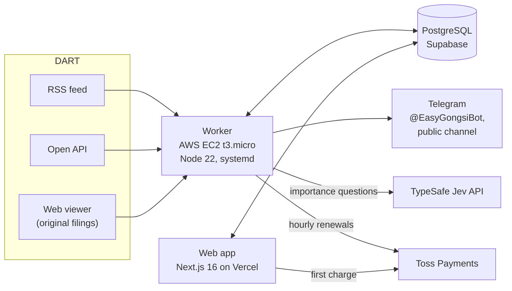

# EasyGongsi (쉬운공시): architecture write-up

[EasyGongsi](https://www.easygongsi.com) turns filings on DART, Korea's electronic corporate disclosure system, into plain-language summaries, key numbers, and alerts for Korean retail investors. It is a personal project, planned, built, and operated by one person, Jae Seong Lee, with Claude Code (see [How it was built](#how-it-was-built)). Live since October 2026.

The application code is in a private repository. This repo describes the system: how filings come in, how scoring, alerts, and billing work, the bugs that shaped it, the decisions and their trade-offs, and the limitations that are still open. Short code excerpts are copied from the private repo, trimmed, with their comments translated from Korean.

## What it does

- **Coverage:** about 1.19M disclosures filed since 2014; 2,652 companies listed on KOSPI and KOSDAQ, Korea's stock markets.
- **Per filing:** classified by type; key numbers extracted (earnings, dividends, financing, ownership stakes); an AI summary (Claude) for subscribers; an importance score from 1 to 10.
- **Alerts:** filings scoring 8 or higher are posted automatically to a public Telegram channel and sent to subscribers. The Telegram bot @EasyGongsiBot also sends watchlist alerts.
- **Watchlist:** up to 20 stocks, with 1 free after login.
- **Subscription:** monthly, billed through Toss Payments, a Korean payment gateway. Launch price ₩14,900 a month, kept fixed for early subscribers. A mid-term cancellation is refunded minus a 10% penalty.
- **Other pages:** National Pension Service holdings (1,206 stocks from the year-end list, plus recent changes from large-shareholding reports); macro indicators from ECOS (Bank of Korea), FRED, EIA, KOSIS (Statistics Korea), and the Korea Customs Service; KRX (Korea Exchange) daily prices since 2015.
- **SEO:** a sitemap of about 10,000 URLs; page titles built from key numbers.
- **Not a product feature:** an admin-only 3D "research office" built with React Three Fiber. Its Kiwoom quotes (Kiwoom is a Korean brokerage) run only on the local machine.

**History.** EasyGongsi started as [Jubabi](https://github.com/jaelee0409/jubabi), an Android app for real-time DART alerts (Aug 2025 – Sep 2026, stopped). In September 2026 the project moved to the web to avoid app-store review and in-app payment overhead. First commit 2026-09-26; renamed EasyGongsi and moved to www.easygongsi.com on 2026-10-01.

## Architecture



Two processes share one database:

- **Web app (Vercel).** Next.js 16 with React 19 and Tailwind CSS 4. Handles Kakao, Google, and Naver login itself (Kakao and Naver are Korean platforms; see [Login without Supabase Auth](#login-without-supabase-auth)). Starts subscriptions and takes the first charge.
- **Worker (AWS EC2 t3.micro).** One Node 22 process, bundled into a single file with esbuild and run by systemd. Collects DART data, runs scheduled jobs (hourly billing renewals, daily jobs), and sends alerts.
- **PostgreSQL (Supabase).** Both processes connect through Supabase's transaction pooler with the postgres.js driver and Drizzle ORM. Each process opens at most 3 connections and closes idle ones after 20 seconds, because Supabase accepts only 15 connections in total across the worker, scripts, local development, and Vercel. postgres.js's default of 10 per process, kept open forever, filled that limit, and pages that run many queries at once failed with "max clients reached".

### Login without Supabase Auth

Supabase Auth was removed on 2026-09-28. Its Kakao provider always requested the email scope (`account_email`), which Kakao rejects with error KOE205 unless the app is registered as a Kakao Biz App. Kakao OAuth is now handled directly:

- It asks only for the nickname and profile image.
- When login starts, a random state (`randomUUID`) and the return path go into a 10-minute cookie; the callback rejects a mismatched state. Kakao and Naver share this.
- Users are keyed by Kakao member number.
- The login is a cookie signed with `AUTH_SECRET` (30 days, httpOnly, SameSite=Lax).

```ts
// src/app/auth/actions.ts: before redirecting to Kakao or Naver, keep a random state in a 10-minute cookie
async function startOAuth(formData: FormData) {
  const next = safeNext(formData.get("next"));
  const state = randomUUID();
  (await cookies()).set(OAUTH_COOKIE, JSON.stringify({ state, next }), {
    httpOnly: true,
    secure: process.env.NODE_ENV === "production",
    sameSite: "lax",
    path: "/",
    maxAge: 600,
  });
  return state;
}

// src/server/auth/oauth.ts: the callback rejects a missing or mismatched state
if (!code || !saved.state || url.searchParams.get("state") !== saved.state) return fail("1");
```

## Ingestion and dedup

| Source | Schedule | Purpose |
|---|---|---|
| DART RSS | every 5 s, 07:00–20:00 KST; every 1 min 06:00–07:00 and 20:00–24:00 | new filings |
| DART Open API, ownership filings | every 60 s; every 5 min in the quiet hours (06:00–07:00 and 20:00–24:00 KST, as for RSS) | ownership filings are not in the RSS feed |
| DART Open API, list call | every 10 min | fills in anything RSS missed |

**Dedup in the database.** New filings are saved with `INSERT … ON CONFLICT DO NOTHING RETURNING`. Only the rows the statement returns, the ones this call actually inserted, go on to follow-up collection and alerts. When the same filing arrives again, from RSS and then the backfill or again after a worker restart, the insert conflicts and returns nothing. Follow-up work and alerts therefore start at most once per filing; [Known limitations](#known-limitations) covers what "at most" costs.

```ts
// src/server/services/realtime.ts (trimmed): RSS ingestion. rcept_no, DART's receipt number, is the primary key
const inserted = await db
  .insert(disclosures)
  .values(matched.map(({ item, company }) => ({ rceptNo: item.rceptNo, corpCode: company.corpCode /* … */ })))
  .onConflictDoNothing()
  .returning(); // only the rows this statement actually inserted

onNewDisclosures(inserted, log, "RSS"); // follow-up work and alerts start from these rows only
```

**Latency logging.** For each filing, the worker logs the lag from DART's receipt time to the moment it showed up in RSS. When a receipt time has only minute precision, the lag is logged as an upper bound (≤ N s).

**Quota.** DART allows 40,000 calls a day per API key. The worker counts its outbound calls.

**Key numbers before the Open API has them.** For preliminary earnings, changes in revenue or profit structure, dividends, supply contracts, and ownership stakes, the Open API may not have the numbers yet when a filing appears. The worker then reads them from the original filing in the DART web viewer: requests 2.5 s apart, retries at 2, 5, and 10 minutes, and a fallback to the Open API after 1 hour.

**Checks on financial statements.** Statements from periodic reports are checked before saving (assets = liabilities + equity, income tax, gross profit) and compared with the Open API's key accounts. Missing revenue was filled in from the full financial statements for 561 reports, for example KRAFTON's 2021 and 2022 reports.

**Bug: a whole stake shown as the change.**

- **How it was found:** the author noticed an implausible change in the product itself: +10.14 percentage points for the National Pension Service's stake in NC. The trace started there.
- **Cause:** the National Pension Service's stake in NC fell below 10%, which ended its major-shareholder (주요주주) reporting, then crossed 10% again (9.76% on Sep 17 → 10.14% on Oct 12). The fresh report listed the previous stake as 0, so the whole stake showed as the change.
- **Fix:** compute the change against the same filer's previous report on the same form. With no earlier report, the filing is labeled "first report" (처음 보고). The National Pension Service page no longer mixes large-shareholding (대량보유) reports into the comparison, because they count differently (10.24% vs 10.14% at the same time).
- **Result:** the same change now shows +0.38 percentage points. The fix applies to the disclosure list and to Telegram alerts.

```ts
// src/server/services/ownership.ts (trimmed)
/** The same filer's previous report on the same form */
async function previousOwnReport(kind: "insider" | "major", r: { corpCode: string; reporter: string; rceptNo: string }) {
  const table = kind === "insider" ? insiderReports : majorHolderReports;
  const [prev] = await db
    .select({ shares: table.shares, pct: table.pct })
    .from(table)
    .where(and(eq(table.corpCode, r.corpCode), eq(table.reporter, r.reporter), sql`${table.rceptNo} < ${r.rceptNo}`))
    .orderBy(desc(table.rceptNo))
    .limit(1);
  return prev;
}

// A fresh report lists the previous stake as 0, so its "change" is the whole stake.
// Recompute the change against the previous report; with none, label it a first report ("처음 보고").
function fixFreshChange(r, prev) {
  if (!isNewHoldingReport(r.sharesChange, r.shares, r.reason) && !isNewHoldingReport(r.pctChange, r.pct)) return r;
  if (!prev) return { ...r, sharesChange: null, pctChange: null, reason: r.reason ?? "처음 보고" };
  return {
    ...r,
    sharesChange: r.shares !== null && prev.shares !== null ? r.shares - prev.shares : null,
    pctChange: r.pct !== null && prev.pct !== null ? Math.round((r.pct - prev.pct) * 100) / 100 : null,
  };
}
```

## Importance scoring and alerts

- Each filing gets a score from 1 to 10: numeric rules plus four questions answered by the TypeSafe Jev API. The scale changed from 1–5 to 1–10 on 2026-10-11.
- **TypeSafe Jev** is TypeSafe AI's API (`POST api.typesafe.ai/v1/systemone`, model `jev-latest`, which was jev-1.13.0 in October 2026). One call answers several structured questions about a text: graded scores, yes/no probabilities, or choices. The questions are in English; the filing data is in Korean. Only the worker calls it.
- **The four questions:**
  - `materiality`: a 10-level scale since rule version 11 (2026-10-11); 5 levels before.
  - `routine`: is this routine administration?
  - `existential`: is survival or control at stake (delisting, default, a change of largest shareholder)?
  - `follow_up`: is this a follow-up to something already announced? (since version 12)
- The rules are versioned: 12 versions by 2026-10-12. A rescore script recomputes stored scores.
- Cost: TypeSafe Jev charges $0.042 per 1M input tokens, and a filing takes about 600–800 tokens, so about $0.025–0.034 per 1,000 filings in input tokens.
- Score 8 or higher: posted automatically to the public Telegram channel and sent to subscribers. Score 6 or higher: listed as a major disclosure (주요 공시) on the site.
- @EasyGongsiBot sends watchlist alerts, and subscriber alerts with an AI summary.
- Delivery is at-most-once today. See [Known limitations](#known-limitations).

## Billing with Toss Payments

- Monthly auto-billing with a Toss billing key, a stored token for recurring charges. Fixed billing day; the renewal job runs hourly in the worker.
- Every charge goes through one function, `charge()`: the first charge (`startSubscription`, on Vercel) and every renewal (worker).
  - On a network error or a temporary Toss error (5xx), it resends once with the same `orderId`. Toss treats the `orderId` as an idempotency key, so it approves that order at most once.
  - If there is still no answer, it looks the payment up by `orderId`: DONE → use it; not found → `NotChargedError`, safe to retry; the lookup fails too → the outcome is unknown, and the original error is thrown.
  - Card declines (400/403) fail right away.
- `orderId` = `${subscriptionId}-${periodStart in base36}-${attempt}`.
- Payment rows are idempotent on a unique `orderId` (`ON CONFLICT DO NOTHING`).

```ts
// src/server/services/billing.ts (trimmed): every charge, first or renewal, goes through here
/** Toss order ID: subscription, start of the billing period, attempt number. Resending the same charge gives the same ID, so Toss approves it once. */
const orderIdFor = (subscriptionId: string, periodStart: Date, attempt: number) =>
  `${subscriptionId}-${periodStart.getTime().toString(36)}-${attempt}`;

/**
 * One charge. On no answer (network) or a temporary Toss error (5xx), send it once more with the same orderId.
 * Still no answer: look the payment up by orderId. Approved → return it; not there → NotChargedError.
 * The lookup fails too → rethrow the original error (approval unknown).
 */
export async function charge(sub, payment): Promise<TossPayment> {
  const request = () => chargeBillingKey(sub.billingKey, { customerKey: sub.customerKey, ...payment });
  let lastError: unknown;
  for (let i = 0; i < 2; i++) {
    try {
      return await request();
    } catch (error) {
      // A card decline (400/403) fails right away; anything temporary is treated like a lost answer
      if (error instanceof TossError && !isTemporaryTossError(error)) throw error;
      lastError = error;
    }
  }
  let found: TossPayment | null;
  try {
    found = await findPaymentByOrderId(payment.orderId);
  } catch {
    throw lastError;
  }
  if (found?.status === "DONE") return found;
  throw new NotChargedError(found ? `Toss payment status ${found.status} (${payment.orderId})` : `no Toss payment (${payment.orderId})`);
}
```

### Two tabs, one charge

- **Problem:** a user can start a subscription from two tabs at the same moment, and both requests must not charge.
- **Decision:** one conditional UPDATE claims the checkout:
  `UPDATE users SET checkout_started_at … WHERE checkout_started_at IS NULL OR <older than the lease> … RETURNING`.
  The request that gets the row goes on to Toss. The request that gets no row returns "busy" without calling Toss.
- **Lease: 5 minutes** (`CHECKOUT_CLAIM_MS`). It is sized to outlast the slowest `startSubscription` (the billing-key step takes about 30 s; the first charge, the resend, and the lookup about 2 minutes), so a second request can't charge while the first is still charging. A request that dies mid-checkout stops blocking after 5 minutes.
- **Release:** in `finally`, and only if the claim is still this request's (`WHERE checkout_started_at = claimedAt`), so a slow request can't wipe a newer claim.
- **Why one statement:** the check and the claim happen together, so there is no gap between reading and writing for a second request to slip into. It is the same idea as the seat claim in [ticket-lab](https://github.com/jaelee0409/ticket-lab), where the conditional UPDATE was load-tested against pessimistic locking, optimistic locking, and a Redis lock.
- **Result and verification:** two tabs subscribing at once → one charge. That follows from the single conditional UPDATE; there are no automated tests, and no test covers it yet. A concurrency test for the claim is next, written by hand.
- **Scope:** this covers concurrent starts only. A user's retry after certain failures can still charge twice; see [Known limitations](#known-limitations).

```ts
// src/server/services/billing.ts (trimmed)
// Longer than the slowest startSubscription (billing key ~30 s + first charge, resend, and lookup ~2 min).
// A request that dies mid-checkout stops blocking the user after 5 minutes.
const CHECKOUT_CLAIM_MS = 5 * 60_000;

// Claim only when there is no claim or it has expired: two requests at once, and only one gets the row back
const claimedAt = new Date();
const [claimed] = await db
  .update(users)
  .set({ checkoutStartedAt: claimedAt })
  .where(
    and(
      eq(users.id, userId),
      or(isNull(users.checkoutStartedAt), lt(users.checkoutStartedAt, new Date(claimedAt.getTime() - CHECKOUT_CLAIM_MS))),
    ),
  )
  .returning({ id: users.id });
if (!claimed) return { ok: false, reason: "busy" }; // the other tab is charging; Toss is never called
```
```ts
try {
  return await startClaimed(input);
} finally {
  // Clear the claim only if it is still ours: if this request outlived the lease and another took over, leave theirs
  await db
    .update(users)
    .set({ checkoutStartedAt: null })
    .where(and(eq(users.id, userId), eq(users.checkoutStartedAt, claimedAt)))
    .catch((error: unknown) => console.error(`could not clear the checkout claim: user=${userId}`, error));
}
```

## AI cost control

**Caps on cost, not on count.** Summaries are for subscribers only, and the limit is money:

- $0.30 per subscriber per 24 hours, shown in the UI as about 15 short summaries (a long filing counts as several).
- $5 per 24 hours across all subscribers. At that point summaries pause and the operator is alerted; admins can still generate. The total cap also guards against multi-account abuse or a bug that regenerates summaries in a loop.
- Why cost and not a count: a short filing costs about $0.02 to summarize and a long one about $0.30 (a long annual report, 사업보고서, first 150k characters; a comparison on 2026-09-30). A long filing costs as much as about 15 short ones, so a count says little about cost.
- A summary is generated once and shared by all subscribers; opening an existing summary isn't counted.
- The cost of each call is computed from that model's price.

**The output check (`summary-check.ts`).** Subscribers see summaries with no human review, so a check runs before a summary is saved. It blocks two things: wrong large numbers and investment-advice wording.

- **Number rule:** only numbers ≥ 10,000 are checked (amounts, share counts); dates and small ratios are skipped to avoid false alarms. A number passes if it appears in the filing, differs only by a unit the filing's table declares (for example "(단위: 백만원)", in millions of won), or is the sum or difference of two numbers in the filing (599,627 − 458,689 = 140,938). Amounts written with 억 (10⁸ won) or 조 (10¹² won) pass within ±10% of a filing amount, which catches order-of-magnitude errors such as "1조 원대" (the ₩1 trillion range) for 10억 (₩1 billion). Only declared units are multiplied, because trying every unit lets a 1,000x error match by chance.
- **Advice filter:** regexes for buy or sell opinions (매수·매도 의견), "buy it" or "sell it" (사세요/파세요), target prices (목표주가), under- or overvalued (저평가·고평가), price forecasts, stock picks (종목 추천), and "promising" (유망). They are tuned so filing language such as 장내매수 (on-market purchase), 공개매수 (tender offer), and 매각 검토 (a sale under review) passes.
- **On a number mismatch:** the summary is regenerated once with the problems appended to the prompt; if it is still wrong, it is hidden.
- **What it can't catch,** per its own comment: a meaning explained backwards, and small number or date errors.

**Model choice.** In a 10-filing comparison on 2026-09-30, Haiku 4.5 got amount units wrong (10억, ₩1 billion, came out as "1조", ₩1 trillion) and misread terms, so summaries stayed on Sonnet 5.5. Disclosure summaries moved to Claude Haiku 5.5 (effort xhigh) on 2026-10-08; company introductions stay on Claude Sonnet 5.5.

Importance questions run on TypeSafe Jev (cost under [Importance scoring and alerts](#importance-scoring-and-alerts)).

```ts
// src/server/services/summaries.ts (trimmed)
// Limits count AI cost, not summaries: a short filing costs about $0.02, a long annual report about $0.30.
// Opening an existing summary is free; each summary is generated once and shared by every subscriber.
const TYPICAL_SUMMARY_USD = 0.02;
export const SUMMARY_DAILY_BUDGET_USD = 0.3; // per subscriber, last 24 hours
const SUMMARY_TOTAL_DAILY_BUDGET_USD = 5; // all subscribers together; also stops multi-account abuse or a regeneration loop

export async function summaryBudgetBlock(userId: string): Promise<"daily" | "paused" | null> {
  if ((await recentSummaryCost(userId)) >= SUMMARY_DAILY_BUDGET_USD) return "daily";
  const total = await recentSummaryCost();
  if (total < SUMMARY_TOTAL_DAILY_BUDGET_USD) return null;
  // … alert the operator, at most once every 6 hours …
  return "paused";
}
```
```ts
// src/server/ai/summary-check.ts (trimmed): every number of 10,000 or more in a summary must come from the filing
const derivable = (n: number) => {
  if (sourceNumbers.has(n)) return true;
  // The same number in a unit the filing's table declares, e.g. "(단위: 백만원)" = in millions of won
  for (const unit of units) if (Number.isInteger(n / unit) && sourceNumbers.has(n / unit)) return true;
  // The sum or difference of two numbers in the filing, e.g. 599,627 − 458,689 = 140,938
  for (const a of big)
    if (sourceNumbers.has(Math.abs(n - a)) || sourceNumbers.has(a - n) || sourceNumbers.has(a + n)) return true;
  return false;
};

// Amounts in 억 (10^8) or 조 (10^12) may be rounded but must land within 10% of an amount in the filing,
// which catches "1조 원" written for what was really 10억
if (!sourceWon.some((s) => s > 0 && Math.abs(s - won) / s <= 0.1)) issues.push(`amount differs in size from the filing: "${m[0]}"`);
```

## Operations

### Worker memory on a t3.micro

- **Incident (2026-10-12):** the worker exhausted memory on the 1 GiB t3.micro. The server froze for 18 minutes, with SSH barely working, until the kernel killed the worker; out-of-memory deaths repeated from 20:05 that day.
- **Cause:** the screener computation read every company's data at once: about 160k financial rows, plus dividends, largest holders, share counts, and EV/EBITDA inputs, nearly 600 MB for that computation alone. The measured peak before any batching was about 570 MB.
- **Steps measured:** 300 companies per batch → about 350 MB. The current code reads 100 per batch and also reads dividend and largest-shareholder data in batches → about 290 MB, heap 90 MB. The step from 350 to 290 MB is not from batch size alone.
- **Decision:** 100 companies per batch, with the dividend and largest-shareholder reads batched too.
- **Guards, from first to last:**
  - `--max-old-space-size=384`. With a loose heap limit, V8 collected late and the screener reached 450–580 MB.
  - A watchdog that alerts the operator and exits at 450 MB RSS.
  - systemd `MemoryHigh=500M` (reclaim and slow down), `MemoryMax=600M` (kill only the worker), and `MemorySwapMax=0` (the worker never swaps; the 1 GB swap is for the rest of the system).
  - `Restart=always`, `RestartSec=10`, `OOMScoreAdjust=500` (the kernel picks the worker before SSH), and `TimeoutStopSec=15`.
- **Restart safety:** daily jobs are recorded in `.worker-done.json`, so a restart doesn't run them twice. A job that died midway is reported when the worker starts again.

```ts
// src/server/services/screener.ts (trimmed). CHUNK = 100.
// Reading every company at once took nearly 600 MB for this computation alone and kept killing the worker on a 1 GiB EC2.
for (let start = 0; start < corps.length; start += CHUNK) {
  const chunk = corps.slice(start, start + CHUNK);
  const codes = chunk.map((c) => c.corpCode);
  const [finRows, dividendRows, holderRows, shareRows, evInputs] = await Promise.all([
    db.select().from(financials).where(inArray(financials.corpCode, codes)),
    db.select().from(dividendReports).where(inArray(dividendReports.corpCode, codes)),
    db.select().from(largestHolders).where(inArray(largestHolders.corpCode, codes)),
    db.select().from(shareCounts).where(inArray(shareCounts.corpCode, codes)),
    getEvInputs(chunk),
  ]);
  // … compute this chunk's metrics; the rows are released before the next chunk …
}
```
```ini
# systemd unit for the worker (from docs/deploy-ec2.md)
[Service]
ExecStart=/usr/bin/node --max-old-space-size=384 dist/worker.mjs
MemoryHigh=500M
MemoryMax=600M
MemorySwapMax=0
OOMScoreAdjust=500
Restart=always
RestartSec=10
```

```ts
// scripts/worker.mts (trimmed): leave before the whole box freezes; systemd starts the worker again 10 s later
const MEMORY_LIMIT_MB = Number(process.env.MEMORY_LIMIT_MB ?? 450);
setInterval(() => {
  const rss = Math.round(process.memoryUsage().rss / 1024 / 1024);
  if (rss < MEMORY_LIMIT_MB || memoryExiting) return;
  memoryExiting = true;
  // … record what was running, alert the operator (waiting at most 5 s), then process.exit(1) …
}, 5_000).unref();
```

### A freeze, then transactions that always failed (postgres.js)

**First problem: every page froze (2026-09-29).**

- **Cause:** with postgres.js's default pipelining, when more queries arrived than there were connections, postgres.js queued several on one connection. Through Supabase's transaction pooler that stalled; the stalled queries held every connection, and every page froze.
- **Fix:** `max_pipeline: 0`, one query per connection at a time.

**Second problem, a side effect: every transaction failed with `UNSAFE_TRANSACTION`** (subscription start and renewal, and the ownership, bond, and screener syncs).

- **Cause:** `sql.begin` only takes a connection that can accept more work, and with pipelining off, none ever can.
- **Fix (same day):** kept `max_pipeline: 0` and added a `transaction()` helper that reserves one connection and runs BEGIN, COMMIT, and ROLLBACK on it.
- **Rule:** inside `transaction()`, only the `tx` argument may be used. Touching the outer `db` would wait for a second connection and can deadlock under load.
- **Checked by hand:** commit, rollback, and 8 transactions plus 8 plain queries at once on 3 connections, which is the load that would expose that deadlock.

```ts
// src/server/db/index.ts
/**
 * Transaction: if anything fails, everything rolls back. db.transaction is NOT used:
 * with max_pipeline: 0, postgres.js's sql.begin can't take a connection ("UNSAFE_TRANSACTION"),
 * because it only takes one that can accept more work, and with pipelining off none ever can.
 * So reserve one connection and run begin and commit on it.
 * Inside, use only the tx argument: touching the outer db waits for a second connection,
 * and under load the requests can end up waiting on each other forever.
 */
export async function transaction<T>(fn: (tx: Tx) => Promise<T>): Promise<T> {
  const reserved = await client.reserve();
  try {
    const tx = drizzle(Object.assign(reserved, { options: client.options }) as unknown as postgres.Sql, { schema });
    await reserved`begin`;
    try {
      const result = await fn(tx);
      await reserved`commit`;
      return result;
    } catch (error) {
      await reserved`rollback`.catch(() => {});
      throw error;
    }
  } finally {
    reserved.release();
  }
}
```

### Health checks and operator tools

- An alert fires when a loop hasn't succeeded for a set time: RSS 5 minutes, ownership 15 minutes.
- A healthchecks.io ping.
- Telegram operator commands (`/status`, `/today`, `/errors`, `/logs`) and a summary every weekday evening.

### Vercel cost

- Only the UI strings a page needs are sent to the browser: about 65 KB less per page.
- Screener metrics and market cap are cached for 30 minutes to cut database egress.

## Key decisions and trade-offs

| Decision | What it buys | What it costs |
|---|---|---|
| Web service instead of the Android app | No app-store review, no in-app payment overhead | Alerts moved from app push notifications to Telegram |
| One always-on worker on a t3.micro, next to Vercel | One place for 5-second polling, scheduled jobs, and alerts | Little memory: the screener had to move to batches, plus heap, swap, MemoryMax, and watchdog guards |
| The database decides what is new (`INSERT … ON CONFLICT DO NOTHING RETURNING`) | A filing seen twice (RSS and the backfill, or after a restart) starts follow-up work and alerts at most once | Alerts fire after the commit with no delivery record, so a crash in between loses them |
| Checkout claimed by one conditional UPDATE with a 5-minute lease | Two tabs at once → one charge, with one column on `users`; a request that dies stops blocking after 5 minutes | Covers concurrent starts only; a user's retry after certain failures can still charge twice |
| Every charge through `charge()`: same-`orderId` resend, then lookup | Inside one request, a lost answer is resent with the same `orderId` and then looked up | A new request gets a new `orderId`, which is the open gap in [Known limitations](#known-limitations) |
| `max_pipeline: 0` | Ended the freeze through the transaction pooler | `sql.begin` stopped working: a `transaction()` helper replaced it, and only `tx` may be used inside |
| Kakao OAuth handled directly instead of Supabase Auth | Login without the email scope (only nickname and profile image) | The state cookie and the signed login cookie are now this code's job |
| Key numbers read from the original filing when the Open API lags | Numbers before the Open API has them | More requests and moving parts: 2.5 s spacing, retries at 2, 5, and 10 minutes, a fallback after 1 hour |
| Summary limits set on cost, not count | A long filing (about 15 short ones' cost) can't blow the budget | The UI can only estimate a count (about 15 short summaries; a long filing counts as several) |
| An automatic check before a summary is saved | Wrong large numbers and investment-advice wording aren't shown | Small number or date errors and reversed meanings can still get through; a number mismatch costs one regeneration, and a summary still wrong is hidden |
| Importance as versioned rules plus Jev questions, with a rescore script | Rules can change and stored scores can be recomputed (12 versions so far) | Jev input tokens for every filing (about 600–800) |

## Known limitations

Both were found in a code review on 2026-10-13 and are open as of 2026-10-17. Their fixes are next.

### 1. Alert delivery is at-most-once

**What happens now.** `onNewDisclosures` fires `void alertNewDisclosures(rows)` without waiting for it, and no delivery record is kept in the database. Follow-up and scoring tasks sit in an in-memory queue (`const queue = new Map`). If the worker dies after the INSERT commits, those alerts are never sent: on restart, the INSERT conflicts and returns no row. Telegram errors other than 403 are logged and dropped with no retry. A 403 means the user blocked the bot, and alerts are turned off for that user, which is correct.

```ts
// src/server/services/realtime.ts (trimmed): what happens right after the INSERT
function onNewDisclosures(rows, log, source) {
  for (const row of rows) {
    const followUpTasks = followUps(row.rceptNo, row.corpCode, row.reportNm, log);
    const scoring = importanceTasks(row, log);
    for (const task of [...followUpTasks, ...scoring]) enqueue(task); // an in-memory queue
  }
  // Alerts aren't awaited, so RSS polling isn't slowed down.
  void alertNewDisclosures(rows, { log });
}
// Nothing records delivery. If the worker dies after the INSERT commits, these alerts are never sent:
// on restart the INSERT conflicts and returns no rows. That is the at-most-once limitation.
```

**Planned fix.**

- An outbox table with a unique `(rcept_no, chat_id)`: one row per filing and recipient (`rcept_no` is DART's receipt number), so delivery state lives in the database instead of memory.
- A sender loop that retries with backoff.
- An alert when pending rows go stale.

### 2. A user's retry can charge twice

**What is handled.** Within one request, a lost Toss answer is handled: `charge()` resends with the same `orderId`, then looks the payment up.

**What is not.** A double charge is possible across requests, in two cases:

- **(a)** Toss approved, but its answer and the lookup both failed. The code writes a payments row with failCode `NETWORK` plus a `console.error`, and the request throws.
- **(b)** Toss approved, but saving the subscription failed. The code logs a `console.error` with the orderId, paymentKey, amount, and user, and writes no payments row.

Either way no subscription is saved, so the user's retry gets a new `subscriptionId` (`randomUUID`) and a new `orderId` (`orderIdFor(subscriptionId, start, 0)`: for a first charge the period start is the time of the attempt, so even the same subscription would get a new `orderId`; the trailing attempt counter stays 0). Toss may charge again. Neither case raises an alert.

**Planned fix.**

- A stable `orderId`, recorded before calling Toss, so a retry reuses it.
- An operator alert for this case.
- Reconciliation of local payment rows against Toss.

## How it was built

- One person did the planning, server, web app, subscription billing, Telegram alerts, and deployment, with Claude Code. 128 of the 130 commits through 2026-10-12 carry a `Co-Authored-By: Claude` trailer, and one merged PR came from a `claude/` branch.
- Claude Code speeds up implementation. Design, code review, operations, and incident response are the author's own work.
- Both known limitations came out of a code review on 2026-10-13. Their fixes will be written by hand.
- **Testing:** there are no automated tests yet. The verifications quoted in this write-up are manual runs recorded in commit messages. A concurrency test for the checkout claim joins the fix list, also written by hand.

## Stack

- **Language:** TypeScript
- **Web:** Next.js 16 (React 19), Tailwind CSS 4, on Vercel
- **Worker:** Node 22 on AWS EC2 t3.micro, bundled into one file with esbuild, run by systemd
- **Database:** PostgreSQL on Supabase (transaction pooler), postgres.js driver, Drizzle ORM
- **AI:** Claude API (Haiku 5.5 for disclosure summaries, Sonnet 5.5 for company introductions); TypeSafe Jev API for importance scoring
- **Payments and messaging:** Toss Payments billing, Telegram Bot API
- **Login:** Kakao, Google, and Naver, handled directly (Supabase Auth removed; see [Login without Supabase Auth](#login-without-supabase-auth))
- **Data sources:** DART (RSS, Open API, web viewer), ECOS, FRED, EIA, KOSIS, Korea Customs Service, KRX
- **Monitoring:** healthchecks.io, Telegram operator commands

## Links

- Live: [www.easygongsi.com](https://www.easygongsi.com)
- The Android app it grew out of: [github.com/jaelee0409/jubabi](https://github.com/jaelee0409/jubabi)
- Author: Jae Seong Lee · jaelee0409@gmail.com · [github.com/jaelee0409](https://github.com/jaelee0409)
